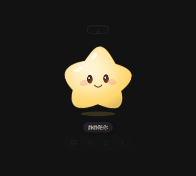

# 星搭子 Starbuddy

常驻桌面的星芽个人电脑助手。你填一个 AI Key，之后把需求交给星搭子：它决定用哪个项目、哪个本机 Agent（Claude Code、Codex 等）、什么模型与思考强度、新开还是续用会话、用哪些 Skill，派单后盯进度，完工把经验写回 Skill 与记忆。

状态：第 0 期，正在从[星笺](https://github.com/cpython666/starclip)拆出星芽角色。当前仓库包含星芽桌面外壳的前端代码、成长系统与网关协议草案；守护进程与 Agent 适配器尚未实现。

## 开发

```sh
npm install
npm test        # 星芽与网关协议单元测试
npm run build   # 类型检查并构建前端
npm run dev     # 浏览器打开 http://127.0.0.1:1420/ 预览星芽外壳
```

浏览器预览用内存演示数据，可以看表情、动作和互动菜单；透明浮窗、拖动与贴边要等 Tauri 工程接入后才能在桌面上看到。每个 PR 的 verify 检查会上传 `starbuddy-preview` 产物，里面有一张星芽截图和构建好的 `dist/`。



## 文档

- [架构与协议](docs/architecture.md)
- [星芽角色](docs/starpet.md)、[设计说明](docs/starpet-design.md)、[成长系统](docs/starpet-growth.md)
- [素材来源核对](docs/artwork-rights.md)

## 许可证

[MIT](LICENSE)。星芽为原创角色，来源记录见 `docs/starpet-design.md`。
